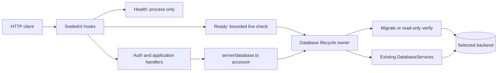

# Implementation Plan: Database review findings remediation

**Branch / planning base / merge target**: `plan/sqlite-postgresql-support`  
**Date**: 2026-10-28 (Europe/Samara)  
**Spec**: [spec.md](spec.md)  
**Inspected revision**: `0572599edc3e79dded5893aaaaef6867394a5288`

## Summary

Repair DRIFT-1 through DRIFT-5 and RISK-1 at the existing persistence and
application boundaries. Preserve the 25-table model, typed repositories, separate
migration histories and backup format. RISK-2 remains unresolved and explicitly
operator-deferred. Workflows, CI/CD behavior and repository settings are frozen.

Use canonical TLS normalization, structural schema verification, explicit startup
migration mode and recoverable initialization. Prove behavior through real drivers,
databases, HTTP requests and manually invoked production images. Extend existing
repository suites with application-path tests; inspection cannot close findings.

## Technical Context

**Language/Version**: TypeScript ~5.9; Node 22 production image (`node:22-alpine`);
record exact installed versions during execution from lockfile and runtime.
**Primary Dependencies**: SvelteKit 2 / Svelte 5, adapter-node, Drizzle ORM,
better-sqlite3, pg, quickjs-emscripten; existing lockfile, no dependency change planned.
**Storage**: SQLite (seven checked migrations, supported legacy adoption) and
PostgreSQL 18 (independent checked history).
**Testing**: Vitest; esbuild child processes; actual adapter-node HTTP;
real TLS/restricted-role/outage scenarios; native recovery; Docker smoke scripts.
**Target Platform**: Linux Node server and existing non-root production image.
**Project Type**: Single SvelteKit application under `okr-app/`.
**Performance Goals**: Probes finish within 5 seconds; outage detection within
10 seconds; recovery within 30 seconds after storage/schema availability.
**Constraints**: No CI/CD edits; required live checks cannot skip; Docker image
download failure stops all mission work until explicit operator direction.
**Scale/Scope**: Six findings spanning config, schema, startup, probes, verification
and operating docs; no new business feature, deployment or backup redesign.

## Engineering alignment

The spec and repository resolve the implementation choices: preserve default
migrate startup; honor explicit `MIGRATION_MODE=verify`; preserve recognized
adoption; reject incompatible schemas before mutation; keep health independent;
leave RISK-2 unresolved with the operator. These choices implement existing
requirements. No unanswered product choice is necessary for this design.
Execution prerequisites and all before/after results remain unverified.

| Decision | Chosen approach | Alternative rejected |
|---|---|---|
| D-01 TLS | Validate every URL TLS control; reject ambiguity/contradiction; strip accepted controls before pg parsing; apply canonical SSL object | Passing the original URL with an SSL object repeats the demonstrated merge defect |
| D-02 Schema | Compare semantic catalog descriptors with supported migration-derived layouts | Names alone miss drift; raw CREATE SQL equality rejects harmless formatting |
| D-03 Runtime mode | Shared runtime/CLI mode parser; read-only verify branches before journal creation | CLI-only mode parsing leaves application startup inconsistent |
| D-04 Recovery | One lifecycle owner serializes attempts, clears failures, fences stale completions | Independent sticky promises prevent retry and leak state |
| D-05 Availability | Bounded live readiness query; share concurrent checks, no stale-success cache | Cached open/version cannot detect outages |
| D-06 Proof | HTTP/application suites plus manual image checks; existing suites retained | Repository-only tests miss guards/bridging; workflow edits violate scope |

Detailed inspection findings and alternatives: [research.md](research.md).

## Charter Check

`spec-kitty charter context --action plan --mission-type software-dev --json`
reported `mode: missing`: `.kittify/charter/charter.yaml` is absent. Project
charter check is skipped, not passed. Built-in action guidance was loaded:
component boundaries, documented decisions, specification fidelity, local changes
and synchronized documentation. Mermaid toolguide loaded through charter context.
No dependency addition, upgrade or removal is planned; no dependency decision or
supply-chain exception is claimed. Post-design check found no spec amendment or
charter violation. This mission is not a bulk edit.

## Architecture and control flow

Probe routes bypass startup-dependent auth/plugin work by exact route identity
and supported probe method, never by a broad API prefix. Health neither opens
storage nor starts plugins. Ready triggers asynchronous initialization if needed
and returns 503 while it runs. Ordinary requests await the same owner before
existing session resolution. Keep backend SQL/driver imports inside `src/lib/db/`.

## Configuration and schema design

### Effective TLS — FR-001

Inventory TLS controls in the installed pg connection-string parser: sslmode,
ssl, certificate/key/rootcert options and aliases. Enumerate all occurrences;
reject duplicated, unsupported or contradictory security controls with redacted
diagnostics. Preserve unrelated connection parameters. URL-only supported modes
resolve through the canonical policy. Strip consumed TLS keys before constructing
pool or migration Client, then apply the configured verification/CA explicitly.
No plaintext fallback and no raw connection URLs or CA material in logs.

Test `new pg.Client(...).connectionParameters.ssl`, not only builder output.
Cover explicit verify-full/custom CA with URL disable, no-verify, require,
verify-full, aliases and duplicate controls. Contradictions may reject; accepted
cases preserve CA, certificate and hostname verification. Real PostgreSQL TLS
must prove trusted matching success, wrong-CA failure and wrong-host failure
through both runtime and migration production builders.

### Semantic SQLite recognition — FR-002

Replace column-name arrays with column descriptors (declared type, nullability,
default, PK position), index descriptors (uniqueness, ordered columns, collation,
direction, expressions and partial predicate), FK descriptors (ordered mappings
and actions) and supported table constraints. Prefer PRAGMA metadata. Compare
constraints absent from PRAGMA using bounded token-aware handling of checked SQL
constructs; preserve string literal contents and reject unsupported constructs.
Do not compare entire SQL strings or erase meaningful tokens.

Derive reference descriptors from checked histories in an isolated in-memory
SQLite database, with explicit supported db:push/adoption variants. Freeze the
supported matrix in fixtures with independent assertions so a shared inspector
is not the sole oracle. Historical migrations stay immutable. Migrate and verify
reuse the same inspector/classifier.

Validate journal structure and known `(hash, created_at)` pairs, uniqueness and
absence of unknown/future/corrupt rows. Supported incomplete journals remain
adoptable only when every existing row is valid; verify requires completeness.
An otherwise empty DB with corrupt journal objects is rejected, not fresh.
Preserve FK data-integrity preflight before adoption.

Inspect/reject before persistent pragmas, DDL or journal writes. Connection-local
busy timeout may be configured before inspection; defer persistent journal-mode
changes until a compatible migration/adoption transaction has committed. Keep classify
and permitted adoption inside the serialized transaction to avoid check/apply
races. Apply only enumerated additive deltas and record history atomically.
Rejection tests compare catalog, data and journal before/after. Verify on a
missing SQLite path must not create a file or directory.

### No-DDL runtime — FR-003

Share migration-mode validation between CLI and application. Missing mode retains
migrate; invalid values fail. PostgreSQL verify uses a read-only transaction,
checks catalog and journal before any createJournal call, and rejects empty,
outdated, incompatible or corrupt storage. Validate physical shape against the
checked PostgreSQL layout; journal presence alone cannot establish compatibility.
No schema/table/sequence/index creation or journal writes in verify mode.

Migration retains dedicated pinned client/advisory lock. Verify uses a consistent
read-only snapshot without DDL. Operational ordering remains migration-job
completion before runtime verify. Test a role owning no application objects with
PUBLIC and runtime CREATE revoked, granting only CONNECT, schema USAGE, needed
DML/sequence privileges and journal SELECT. Record attempted statements plus
before/after object inventories on both success and rejection paths.

No business-table migration or backup-format change is required. A newly found
spec conflict or unsupported historical-layout promise returns to specify rather
than silently expanding adoption.

## Recoverable lifecycle and probes — FR-006

```mermaid
stateDiagram-v2
    [*] --> Uninitialized
    Uninitialized --> Opening: request or readiness trigger
    Opening --> Ready: schema validation and open succeed
    Opening --> Retryable: failure and resource cleanup
    Retryable --> Opening: demand after cooldown
    Ready --> Unavailable: live check or idle error fails
    Unavailable --> Ready: same pool recovers; live check succeeds
    Unavailable --> Opening: invalid owner requires recreation
    Ready --> Closing: shutdown
    Retryable --> Closing: shutdown
    Unavailable --> Closing: shutdown
    Opening --> Closing: shutdown fences attempt
    Closing --> Closed: stop jobs and release resources
```

`src/lib/db/lifecycle.ts` owns the state; `server/database.ts` delegates rather
than caching a second rejected promise. Share one opening attempt, clear its
promise in finally and publish services/schema version only on success. Close
partially opened resources on failure. Generation fencing prevents completion
after shutdown/reset from resurrecting state. Cooldown at most 1 second; no
unbounded loop, overlapping opens or hidden test retries.

Add `checkAvailability` to DatabaseServices, implemented by a live query on a
required application table. Make readiness asynchronous and audit all callers
of getReadiness. Keep existing redacted response fields. PostgreSQL checks bound
checkout plus query time, explicitly release/destroy resources on timeout and
handle idle pool errors without uncaught process termination. A Promise.race
alone cannot cancel underlying driver work. Recovery permits reuse/reconnection;
never automatically replay failed application writes.

Use a 3-second total probe budget including checkout/query/response overhead;
set lower driver deadlines within it. Share in-flight availability checks, but
never serve a cached successful result after a failed live check. Acceptance
polling is every second. Initialization may run longer; probes return 503 while
it continues. Run SQLite synchronous migration and lock waits in a Node worker
with its own handle so they cannot block health. Package the worker for the
production adapter-node build. Wait for worker cleanup before retry. SQLite
availability queries use a lock wait below the probe budget; verify responsiveness
under a held lock. Database-worker scope is startup work, not a repository rewrite.

Hooks clear failed plugin initialization in finally and start scheduler only once
after storage is usable. Track/clear both initial timeout and recurring interval
on shutdown. Retry/outage cannot multiply schedulers. Auth failures never bypass
session/ownership guards. Detailed external contract: [runtime-and-verification.md](contracts/runtime-and-verification.md).

## Application and operational proof — FR-004, FR-005

Create a shared real-backend suite under `okr-app/tests/application/` with SQLite
and PostgreSQL entry files. Start the built adapter-node app on an isolated port
and migrated database, obtain actual registration/login cookies, and use separate
admin/Alice/Bob cookie jars. Teardown owns processes, timers, roles and databases.
Use checked migrations, not the hand-written low-level proof DDL.

Exercise unauthenticated/non-admin denial, admin success, session/logout, two-user
reads/writes/deletes, private/shared friend dashboards, saved-query persistence
and execution, and AI-tool persistence through `/api/ai/tool`. Denials assert no
foreign response data and unchanged persisted rows. QuickJS must run asynchronous
data reads through executeQuery and the actual bridge with exact seeded results
and audit logs. Exercise scheduler's scheduled callback and manager writes using
a deterministic upstream plugin provider; only external provider I/O may be a
fixture. Do not mock auth, repositories, QuickJS or persistence, or add a public
test endpoint. Keep existing repository suites intact.

Demonstrate sensitivity through recorded isolated controlled faults: remove an
admin guard, remove an ownership filter, break async bridge result handling.
Each targeted regression must fail, then pass after restoration. Fault runs must
not modify the primary worktree or enter final code.

Migrate PostgreSQL operational fixtures before users/pool/outage assertions and
assert tables exist before the target scenario. Required PostgreSQL/recovery
commands fail if server/admin URL or matching pg_dump/pg_restore/psql is absent;
no required-mode describe.skip. Native recovery verifies seeded installation data.

Harden container scripts: bounded curl, checked statuses, exact JSON ID/field
comparison, explicit live PostgreSQL prerequisite, fatal restart-readiness and
missing-write failures. Preserve the same user/objective across restart; re-login
if needed without recreating data. Both modes test the same recorded production
image ID (digest when available; label local ID accurately). Controlled lost-write
and never-ready runs must exit nonzero. Retain PostgreSQL no-SQLite checks.
No workflow or publication changes.

## Verification and evidence

| Finding | Regression boundary | Required executed evidence |
|---|---|---|
| DRIFT-1 | Effective Client + real TLS | URL/CA-loss baseline; canonical settings; trusted/wrong-CA/wrong-host outcomes |
| DRIFT-2 | Real SQLite migrate/verify | Expected-name wrong-column nonunique index, column/FK/constraint/journal tampering; no mutation; fresh/supported positives |
| DRIFT-3 | Startup + live restricted role | Mode propagation; zero attempted DDL and unchanged objects for migrated/empty/outdated/incompatible databases |
| DRIFT-4 | Live PostgreSQL + native recovery + images | Migrated pool/outage fixtures, restore, both-mode restart persistence and failing lost-write/readiness cases |
| DRIFT-5 | HTTP/session/application entrypoints | Both-backend auth/admin/ownership/privacy, scheduler, QuickJS, saved query, friend and AI; fault sensitivity |
| RISK-1 | Actual HTTP and driver lifecycle | Unavailable startup → recovery → outage → recovery; concurrent init, rejected promise, idle errors and timed probes |
| RISK-2 | Disposition only | Unresolved, explicitly operator-deferred; CI/CD unchanged |

For every in-scope row, preserve a baseline failing regression or documented
controlled equivalent, then the same fixed passing scenario. Distinguish fixture
failure from the intended assertion. Record current UI diagnostic baseline by
identity; historical 18 errors/4 warnings are not an allowance. Diagnose
concurrency/no-init failures from child exit code, signal, stdout/stderr and
isolated bundle paths, without retries or weaker assertions.

Final required checks: npm test, SQLite backend, PostgreSQL backend/native
recovery, both application suites, build, UI diagnostic comparison and both-mode
production images. Concurrency/no-init tests pass ten consecutive runs, Vitest
retry disabled. Every mandatory live scenario executes; missing execution stays
incomplete. See [quickstart.md](quickstart.md) for ordering.

Requirement trace: FR-001–FR-006 map to the finding rows above; FR-007 preserves
the unresolved RISK-2 disposition; FR-008 requires durable closure. NFR-001 requires
complete execution evidence, NFR-002 sets probe deadlines, NFR-003 requires green
mandatory suites and ten-run stability, and NFR-004 requires redacted provenance.
C-001/C-002/C-003/C-006 freeze delivery behavior; C-004 prohibits weakening,
C-005 bounds application scope and C-007 enforces the image-download stop rule.
SC-001/SC-006 require all six durable closures, SC-002 green/stable execution,
SC-003 restart persistence, SC-004 bounded recovery, SC-005 CI preservation and
SC-007 the stop-and-ask behavior. No requirement is removed or deferred here.

Commit redacted evidence under
`okr-app/docs/reviews/evidence/database-review-remediation/` and link from the new
`okr-app/docs/reviews/database-review-findings-remediation.md`. Every run records
command (secret placeholders), UTC times, exit code, source revision/dirty diff
identity, driver/backend/native-tool versions, image identity and checksums.
Temporary logs alone cannot close a finding. Never commit passwords, cookies,
private CA keys or credential URLs. Preserve the historical review.

## Project Structure

Planning artifacts under this mission: plan.md, research.md, data-model.md,
quickstart.md and contracts/runtime-and-verification.md. No tasks generated here.

| Implementation surface under `okr-app/` | Responsibility |
|---|---|
| src/lib/db/config.ts; scripts/db-migrate.ts | Canonical TLS/shared migration mode |
| src/lib/db/contracts.ts; lifecycle.ts; adapters/ | Availability, serialized lifecycle, idle errors |
| src/lib/db/migrations/ | Semantic descriptors, shared inspection, read-only verify, startup worker |
| src/lib/server/database.ts; src/hooks.server.ts; src/routes/api/{health,ready}/ | Runtime mode, auth/plugin ordering and HTTP probes |
| src/lib/server/plugins/scheduler.ts | Timer lifecycle and bounded internal test seam |
| tests/db/; tests/recovery/ | Schema/TLS/no-DDL/stability/operational/native regressions |
| tests/application/ (new) | Built-server HTTP and real application suites |
| tests/container/; package.json | Truthful manual checks and required test entrypoints |
| Dockerfile; build configuration if needed | Include startup worker in existing production build |
| docs/DATABASES.md; docs/DATABASE-VERIFICATION.md; tests/container/README.md | Demonstrated behavior and execution instructions |
| docs/reviews/database-review-findings-remediation.md; evidence/database-review-remediation/ (new) | Closure rows and durable artifacts |

No implementation surface in `.github/workflows/` or repository settings.

## Implementation Concern Map

Concerns guide later task decomposition; they are not work packages.

| ID | Purpose / requirements | Affected surfaces | Dependencies | Risk |
|---|---|---|---|---|
| IC-01 | Effective TLS; FR-001 | config, effective Client tests, live TLS fixtures | None | Parser controls erase verification |
| IC-02 | Schema/journal integrity; FR-002 | migration contracts, fingerprint, inspector, expected layouts, fixtures | None | Legacy false rejection or mutation before reject |
| IC-03 | No-DDL startup; FR-003 | shared mode, CLI/accessor, migration/verify branches | IC-01; coordinate descriptors with IC-02 | Verify mutates before checking |
| IC-04 | Recovery/probes; FR-006, NFR-002 | lifecycle/adapters/hooks/probes, startup worker, scheduler cleanup | IC-03 | Sticky state, leaked work, stale readiness, event-loop blocking |
| IC-05 | Real application/operational tests; FR-004/005, NFR-003 | fixtures, HTTP/app suites, native recovery | IC-01–04 for final green runs; baseline capture before fixes | Fixture fails before target assertion |
| IC-06 | Manual image proof/closure; FR-004/007/008, NFR-001/004 | container scripts, docs, report/evidence | IC-01–05 | False PASS, undurable logs, CI scope creep |

## Rollout, rollback and risks

Capture regressions before each fix. Complete schema/mode integration before
lifecycle integration and full application/image proof. Default migrate behavior
remains available; verify deployments complete privileged migration first.
Stricter recognition may expose existing drift: reject with actionable diagnostics
and preserve storage for explicit operator remediation. Never auto-repair drift.

No production deployment, down-migration, business data rewrite or new schema
version is planned. Prior-code rollback requires understanding the failure and
must not be presented as remediation for TLS/schema defects. Native recovery
contracts remain unchanged and require matching-tool rehearsal.

| Risk | Mitigation / proof |
|---|---|
| Inspector misses CHECK/default/index semantics | Explicit descriptors, bounded token handling, one tamper per dimension, supported-layout positives |
| Deadline leaves outstanding work | Driver/worker cleanup, one attempt, shutdown fencing, held-lock/saturated-pool tests |
| HTTP fixture hides auth behavior | Actual built app, login cookies, separate accounts and DB state assertions |
| Fixture DDL diverges | Checked migrations for new operational/application fixtures |
| Missing PostgreSQL/recovery prerequisites | Explicit incomplete/failure of prerequisite, never skipped PASS |
| Required Docker image cannot download | Immediately stop ALL mission work, report exact image/tag/digest, registry, command and redacted error; ask operator and wait for explicit direction; no substitute, registry/proxy/TLS workaround or unrelated continuation |
| CI freeze versus test discoverability | Package/manual entrypoints only; verify workflow tree unchanged; retain unresolved RISK-2 |

## Completion boundary

Planning only: implementation, live verification and finding closure are pending.
This design is ready for task decomposition; it claims no regression PASS.
`/spec-kitty.tasks` is a separate explicit user invocation. Do not create work
packages or implement changes as part of this phase.
