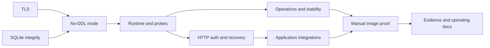

# Work packages: Database review findings remediation

**Mission**: `database-review-findings-remediation-01M5TGCE`.
**Planning base / merge target**: `plan/sqlite-postgresql-support`.
**Status**: Task authoring only; implementation/review/execution pending.
**Inputs**: [spec.md](spec.md), [plan.md](plan.md), [research.md](research.md),
[data-model.md](data-model.md), [runtime contract](contracts/runtime-and-verification.md),
[quickstart.md](quickstart.md).

All six in-scope findings require executed regression and durable before/after
proof. RISK-2 remains unresolved/operator-deferred. CI/CD/workflows/settings are
frozen. A required Docker image download failure immediately stops ALL mission
work until operator help and explicit direction; no workaround or substituted image.

## Package graph and sequencing

WP09 also depends directly on WP01–WP07 for their evidence handoffs.
WP01/WP02 are independent; WP05/WP06 can proceed independently after WP04.
These are dependency opportunities only; actual execution lanes come from
finalizer-generated lanes.json. No agent delegation is started by task authoring.

## Ownership and interface safeguards

- WP01 exclusively owns config.ts; shared migration-mode helper belongs to WP03.
- WP02 owns SQLite descriptor contracts/inspection; WP03 consumes them and owns migration orchestration/PostgreSQL verification.
- WP04 exclusively owns lifecycle/adapters/hooks/probes, package.json, Dockerfile and worker/build integration.
- WP05 owns operational/recovery/stability tests and required PostgreSQL preflight; WP04 wires the commands.
- WP06 owns the built HTTP fixture and backend entry files. WP07 imports that fixture and writes separate integration/provider files.
- WP07 owns scheduler/query/friend/AI integration source changes if demonstrated necessary; no speculative product changes.
- WP08 owns container scripts/README; package/build requests go to WP04.
- Every WP owns a distinct evidence subdirectory. WP09 owns final reconciliation evidence and links earlier artifacts.
- Coordinate small necessary out-of-map fixes explicitly. No two WPs may claim the same source path implicitly.

No partial MVP can satisfy mission acceptance: all six findings need proof. WP01
is the first independently reviewable security increment, not release readiness.

## Work package overview

| WP | Goal | Subtasks | Dependencies | Concern/finding |
|---|---|---:|---|---|
| [WP01](tasks/WP01-effective-postgres-tls.md) | Enforce effective PostgreSQL TLS | 4 | None | IC-01 / DRIFT-1 |
| [WP02](tasks/WP02-sqlite-semantic-integrity.md) | Reject incompatible SQLite definitions | 5 | None | IC-02 / DRIFT-2 |
| [WP03](tasks/WP03-read-only-runtime-mode.md) | Honor no-DDL runtime verification | 4 | WP01, WP02 | IC-03 / DRIFT-3 |
| [WP04](tasks/WP04-recoverable-runtime-and-probes.md) | Recover initialization and keep probes truthful | 7 | WP03 | IC-04 / RISK-1 + startup mode |
| [WP05](tasks/WP05-operational-and-stability-regressions.md) | Repair PostgreSQL operations and stability evidence | 4 | WP04 | IC-05 / DRIFT-4 + stability |
| [WP06](tasks/WP06-http-auth-and-probe-scenarios.md) | Prove HTTP authorization and outage recovery | 5 | WP04 | IC-05 / DRIFT-5 + RISK-1 HTTP |
| [WP07](tasks/WP07-application-integrations.md) | Verify scheduler query friend and AI paths | 5 | WP06 | IC-05 / DRIFT-5 application |
| [WP08](tasks/WP08-manual-production-images.md) | Make manual image verification fail truthfully | 4 | WP05, WP07 | IC-06 / DRIFT-4 images |
| [WP09](tasks/WP09-durable-closure-and-docs.md) | Reconcile evidence and operating documentation | 5 | WP01, WP02, WP03, WP04, WP05, WP06, WP07, WP08 | IC-06 / FR-008 + RISK-2 disposition |

## Work packages

### WP01 — Enforce effective PostgreSQL TLS

**Priority**: P1. **Dependencies**: None.
**Requirements**: FR-001, FR-008, NFR-001, NFR-004.

Configured certificate/hostname verification and custom CA survive the actual pg parser for runtime and migration connections.

**Independent test**: Effective pg Client matrix plus real trusted/wrong-CA/wrong-host PostgreSQL TLS outcomes; retain redacted before/after runs.

**Prompt**: [tasks/WP01-effective-postgres-tls.md](tasks/WP01-effective-postgres-tls.md).

T001 Capture parser and TLS regression baseline (WP01)

T002 Normalize canonical TLS policy (WP01)

T003 Execute real PostgreSQL TLS cases (WP01)

T004 Publish TLS regression evidence (WP01)

**Implementation sketch**: Complete the referenced subtasks in order: baseline/fault capture, bounded change, required negative/positive execution, durable evidence.

**Parallel opportunities**: Independent of WP02.

**Risk**: URL aliases and repeated keys can bypass a first-value lookup; never preserve parser security controls in the final connection string.

**Prompt size**: 233 lines; 4 subtasks.

### WP02 — Reject incompatible SQLite definitions

**Priority**: P1. **Dependencies**: None.
**Requirements**: FR-002, FR-008, NFR-001, NFR-004.

Migrate and verify share semantic recognition and reject incompatible definitions before persistent mutation while preserving every supported historical layout.

**Independent test**: Real SQLite tamper matrix, catalog/data/journal no-mutation assertions and fresh/db:push/incomplete-journal/additive adoption positives.

**Prompt**: [tasks/WP02-sqlite-semantic-integrity.md](tasks/WP02-sqlite-semantic-integrity.md).

T005 Reproduce expected-name drift and freeze supported layouts (WP02)

T006 Introduce shared semantic schema descriptors (WP02)

T007 Validate full journal integrity and classify safely (WP02)

T008 Integrate inspection before mutation and preserve atomic adoption (WP02)

T009 Execute schema tamper and formatting matrix (WP02)

**Implementation sketch**: Complete the referenced subtasks in order: baseline/fault capture, bounded change, required negative/positive execution, durable evidence.

**Parallel opportunities**: Independent of WP01.

**Risk**: Expected metadata and actual metadata can share the same bug; use independent assertions and explicit supported variants.

**Prompt size**: 258 lines; 5 subtasks.

### WP03 — Honor no-DDL runtime verification

**Priority**: P1. **Dependencies**: WP01, WP02.
**Requirements**: FR-003, FR-008, NFR-001, NFR-004.

Application/CLI migration mode has one parser and verify performs no DDL or journal mutation on both successful and rejected storage.

**Independent test**: Live objectless runtime role with PUBLIC/runtime CREATE revoked, statement capture and object inventories on migrated/empty/outdated/incompatible storage.

**Prompt**: [tasks/WP03-read-only-runtime-mode.md](tasks/WP03-read-only-runtime-mode.md).

T010 Establish shared migration-mode contract (WP03)

T011 Split PostgreSQL inspection from privileged migration (WP03)

T012 Make SQLite verify noncreating (WP03)

T013 Prove restricted-role no-DDL behavior (WP03)

**Implementation sketch**: Complete the referenced subtasks in order: baseline/fault capture, bounded change, required negative/positive execution, durable evidence.

**Parallel opportunities**: Follow declared dependency chain; do not edit another package surface.

**Risk**: Verify must branch before createJournal; journal presence alone does not establish physical schema compatibility.

**Prompt size**: 237 lines; 4 subtasks.

### WP04 — Recover initialization and keep probes truthful

**Priority**: P1. **Dependencies**: WP03.
**Requirements**: FR-003, FR-006, FR-008, NFR-001, NFR-002, NFR-004.

One retryable lifecycle owner supports explicit runtime verification, bounded live readiness and process-only health without stale attempts or leaked resources.

**Independent test**: Focused real-backend lifecycle/availability tests, mode propagation and built worker smoke; WP06 supplies full timed HTTP outage traces.

**Prompt**: [tasks/WP04-recoverable-runtime-and-probes.md](tasks/WP04-recoverable-runtime-and-probes.md).

T014 Capture failures and define lifecycle ownership (WP04)

T015 Add bounded live availability to adapters (WP04)

T016 Consume runtime mode and remove sticky accessor cache (WP04)

T017 Separate exact probe routes from startup and auth (WP04)

T018 Isolate SQLite startup work and package worker (WP04)

T019 Register required test entrypoints without CI edits (WP04)

T020 Execute lifecycle integration and publish evidence (WP04)

**Implementation sketch**: Complete the referenced subtasks in order: baseline/fault capture, bounded change, required negative/positive execution, durable evidence.

**Parallel opportunities**: Follow declared dependency chain; do not edit another package surface.

**Risk**: Async wrappers do not make better-sqlite3 nonblocking; Promise.race alone does not cancel pg checkout/query work.

**Prompt size**: 302 lines; 7 subtasks.

### WP05 — Repair PostgreSQL operations and stability evidence

**Priority**: P1. **Dependencies**: WP04.
**Requirements**: FR-004, FR-006, FR-008, NFR-001, NFR-003, NFR-004.

Operational scenarios reach real assertions on migrated storage, native recovery cannot skip required prerequisites, and concurrency/no-init regressions are stable.

**Independent test**: Migrated live pool/outage suite, seeded native dump/restore and ten consecutive independent concurrency/no-init passes without retries.

**Prompt**: [tasks/WP05-operational-and-stability-regressions.md](tasks/WP05-operational-and-stability-regressions.md).

T021 Migrate disposable operational databases (WP05)

T022 Fail required PostgreSQL prerequisite checks explicitly (WP05)

T023 Execute native full-installation recovery (WP05)

T024 Diagnose and prove concurrency/no-init stability (WP05)

**Implementation sketch**: Complete the referenced subtasks in order: baseline/fault capture, bounded change, required negative/positive execution, durable evidence.

**Parallel opportunities**: Independent of WP06 after WP04.

**Risk**: Broken fixture setup can fail before outage assertions; an entirely skipped recovery suite is not a successful required run.

**Prompt size**: 235 lines; 4 subtasks.

### WP06 — Prove HTTP authorization and outage recovery

**Priority**: P1. **Dependencies**: WP04.
**Requirements**: FR-003, FR-005, FR-006, FR-008, NFR-001, NFR-002, NFR-004.

Real cookie/session/admin/two-account HTTP paths and timed storage outage/recovery work on both backends in the built server.

**Independent test**: Actual request/response/state assertions, controlled guard/ownership faults, and timed health/readiness traces with unchanged PID.

**Prompt**: [tasks/WP06-http-auth-and-probe-scenarios.md](tasks/WP06-http-auth-and-probe-scenarios.md).

T025 Build isolated production HTTP fixture (WP06)

T026 Exercise real session and admin requests (WP06)

T027 Prove two-account objective ownership (WP06)

T028 Record startup and repeated outage HTTP timing (WP06)

T029 Demonstrate authorization regression sensitivity (WP06)

**Implementation sketch**: Complete the referenced subtasks in order: baseline/fault capture, bounded change, required negative/positive execution, durable evidence.

**Parallel opportunities**: Independent of WP05 after WP04.

**Risk**: Injecting locals bypasses session auth; asserting only status can miss leaked data or unauthorized writes.

**Prompt size**: 256 lines; 5 subtasks.

### WP07 — Verify scheduler query friend and AI paths

**Priority**: P1. **Dependencies**: WP06.
**Requirements**: FR-005, FR-008, NFR-001, NFR-004.

Scheduler, QuickJS async bridge, saved queries, friend dashboard and AI tools are tested through real application entrypoints on both real databases.

**Independent test**: Persisted results from scheduled callback/manager, exact async query outputs, privacy/ownership denials and AI writes plus controlled broken-bridge failure.

**Prompt**: [tasks/WP07-application-integrations.md](tasks/WP07-application-integrations.md).

T030 Prove actual scheduled plugin persistence (WP07)

T031 Exercise real asynchronous QuickJS data access (WP07)

T032 Verify saved-query and friend-dashboard paths (WP07)

T033 Prove AI-tool persistence and ownership (WP07)

T034 Demonstrate bridge sensitivity and publish integration proof (WP07)

**Implementation sketch**: Complete the referenced subtasks in order: baseline/fault capture, bounded change, required negative/positive execution, durable evidence.

**Parallel opportunities**: Follow declared dependency chain; do not edit another package surface.

**Risk**: Repository CRUD alone cannot establish the application chain; only external provider data may be simulated.

**Prompt size**: 256 lines; 5 subtasks.

### WP08 — Make manual image verification fail truthfully

**Priority**: P1. **Dependencies**: WP05, WP07.
**Requirements**: FR-004, FR-008, NFR-001, NFR-002, NFR-004.

Manually initiated production-image validation proves both-backend objective persistence after restart and exits nonzero for loss or unreadiness.

**Independent test**: Same built production image identity, live PostgreSQL and SQLite write/restart/exact-read runs plus failing lost-write and never-ready controls.

**Prompt**: [tasks/WP08-manual-production-images.md](tasks/WP08-manual-production-images.md).

T035 Reproduce false positive and harden shared helpers (WP08)

T036 Enforce exact write restart read in both modes (WP08)

T037 Run manual positive and negative image scenarios (WP08)

T038 Document truthful image execution and evidence (WP08)

**Implementation sketch**: Complete the referenced subtasks in order: baseline/fault capture, bounded change, required negative/positive execution, durable evidence.

**Parallel opportunities**: Follow declared dependency chain; do not edit another package surface.

**Risk**: Tolerated readiness failure or grep-only ID checks can produce false PASS; optional no-DB PostgreSQL mode cannot close live verification.

**Prompt size**: 234 lines; 4 subtasks.

### WP09 — Reconcile evidence and operating documentation

**Priority**: P1. **Dependencies**: WP01, WP02, WP03, WP04, WP05, WP06, WP07, WP08.
**Requirements**: FR-007, FR-008, NFR-001, NFR-003, NFR-004.

Every in-scope finding has complete durable before/after proof and accurate operating docs; RISK-2 remains explicitly unresolved/operator-deferred.

**Independent test**: Final full/backend/application/build/stability/image evidence reconciliation, six complete disposition rows and unchanged CI/CD surfaces.

**Prompt**: [tasks/WP09-durable-closure-and-docs.md](tasks/WP09-durable-closure-and-docs.md).

T039 Inventory finding evidence and provenance (WP09)

T040 Execute integrated required suites and UI comparison (WP09)

T041 Align database operating and verification docs (WP09)

T042 Write closure report retaining operator deferral (WP09)

T043 Verify mission constraints and hand off acceptance (WP09)

**Implementation sketch**: Complete the referenced subtasks in order: baseline/fault capture, bounded change, required negative/positive execution, durable evidence.

**Parallel opportunities**: Follow declared dependency chain; do not edit another package surface.

**Risk**: Green test references are not executed evidence; historical UI error counts are not a permanent allowance.

**Prompt size**: 251 lines; 5 subtasks.

## Completion tracking and final gates

Reference rows above are not checkboxes and do not indicate completion.
Record completion through the event log using `spec-kitty agent tasks mark-status`
with explicit mission selection. All packages remain unstarted at task generation.

Run `/spec-kitty.analyze` and persist analysis-report.md before implementing any WP.
The implementation gate enforces this prerequisite. Runtime owns workspaces and
review transitions. No implementation, lane allocation by hand or deployment is
authorized by this task-generation artifact.

Final acceptance requires all required/full/backend/application suites green,
native PG recovery, ten consecutive concurrency/no-init passes, measured 5/10/30s
probe bounds, both-mode production restart proof and no missing evidence. Existing
UI diagnostics need reproducible baseline comparison; no new errors may hide in debt.
Verify CI/CD/workflows/settings and historical review unchanged. No in-scope
waiver or deferral is allowed; RISK-2 is the explicit operator-owned exception.

## Subtask Index

| Subtask | Description | Package | Parallel |
|---|---|---|---|
| T001 | Capture parser and TLS regression baseline | WP01 | Independent WP branch; subtasks sequential |
| T002 | Normalize canonical TLS policy | WP01 | Independent WP branch; subtasks sequential |
| T003 | Execute real PostgreSQL TLS cases | WP01 | Independent WP branch; subtasks sequential |
| T004 | Publish TLS regression evidence | WP01 | Independent WP branch; subtasks sequential |
| T005 | Reproduce expected-name drift and freeze supported layouts | WP02 | Independent WP branch; subtasks sequential |
| T006 | Introduce shared semantic schema descriptors | WP02 | Independent WP branch; subtasks sequential |
| T007 | Validate full journal integrity and classify safely | WP02 | Independent WP branch; subtasks sequential |
| T008 | Integrate inspection before mutation and preserve atomic adoption | WP02 | Independent WP branch; subtasks sequential |
| T009 | Execute schema tamper and formatting matrix | WP02 | Independent WP branch; subtasks sequential |
| T010 | Establish shared migration-mode contract | WP03 | After dependencies |
| T011 | Split PostgreSQL inspection from privileged migration | WP03 | After dependencies |
| T012 | Make SQLite verify noncreating | WP03 | After dependencies |
| T013 | Prove restricted-role no-DDL behavior | WP03 | After dependencies |
| T014 | Capture failures and define lifecycle ownership | WP04 | After dependencies |
| T015 | Add bounded live availability to adapters | WP04 | After dependencies |
| T016 | Consume runtime mode and remove sticky accessor cache | WP04 | After dependencies |
| T017 | Separate exact probe routes from startup and auth | WP04 | After dependencies |
| T018 | Isolate SQLite startup work and package worker | WP04 | After dependencies |
| T019 | Register required test entrypoints without CI edits | WP04 | After dependencies |
| T020 | Execute lifecycle integration and publish evidence | WP04 | After dependencies |
| T021 | Migrate disposable operational databases | WP05 | Independent WP branch; subtasks sequential |
| T022 | Fail required PostgreSQL prerequisite checks explicitly | WP05 | Independent WP branch; subtasks sequential |
| T023 | Execute native full-installation recovery | WP05 | Independent WP branch; subtasks sequential |
| T024 | Diagnose and prove concurrency/no-init stability | WP05 | Independent WP branch; subtasks sequential |
| T025 | Build isolated production HTTP fixture | WP06 | Independent WP branch; subtasks sequential |
| T026 | Exercise real session and admin requests | WP06 | Independent WP branch; subtasks sequential |
| T027 | Prove two-account objective ownership | WP06 | Independent WP branch; subtasks sequential |
| T028 | Record startup and repeated outage HTTP timing | WP06 | Independent WP branch; subtasks sequential |
| T029 | Demonstrate authorization regression sensitivity | WP06 | Independent WP branch; subtasks sequential |
| T030 | Prove actual scheduled plugin persistence | WP07 | After dependencies |
| T031 | Exercise real asynchronous QuickJS data access | WP07 | After dependencies |
| T032 | Verify saved-query and friend-dashboard paths | WP07 | After dependencies |
| T033 | Prove AI-tool persistence and ownership | WP07 | After dependencies |
| T034 | Demonstrate bridge sensitivity and publish integration proof | WP07 | After dependencies |
| T035 | Reproduce false positive and harden shared helpers | WP08 | After dependencies |
| T036 | Enforce exact write restart read in both modes | WP08 | After dependencies |
| T037 | Run manual positive and negative image scenarios | WP08 | After dependencies |
| T038 | Document truthful image execution and evidence | WP08 | After dependencies |
| T039 | Inventory finding evidence and provenance | WP09 | After dependencies |
| T040 | Execute integrated required suites and UI comparison | WP09 | After dependencies |
| T041 | Align database operating and verification docs | WP09 | After dependencies |
| T042 | Write closure report retaining operator deferral | WP09 | After dependencies |
| T043 | Verify mission constraints and hand off acceptance | WP09 | After dependencies |
