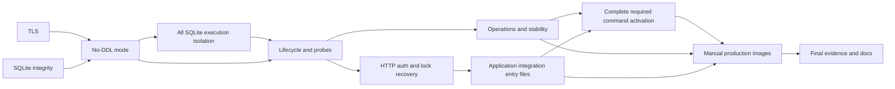

# Work packages: Database review findings remediation

**Mission**: `database-review-findings-remediation-01M5TGCE`.
**Planning base / merge target**: `plan/sqlite-postgresql-support`.
**Status**: Planning amendments only; implementation/review remain unstarted.
**Execution handoff**: Qwen CLI (`qwen`) on the operator's other device.
**Inputs**: [spec.md](spec.md), [plan.md](plan.md), [research.md](research.md),
[data-model.md](data-model.md), [runtime contract](contracts/runtime-and-verification.md),
[quickstart.md](quickstart.md).

All six in-scope findings require executed regression and durable before/after
proof. RISK-2 remains unresolved/operator-deferred. CI/CD/workflows/settings are
frozen. Any required image-download failure stops ALL mission work until explicit
operator direction. No substitute image/registry/network workaround is allowed.

## Package graph and sequencing

WP09 also depends directly on every other package's evidence. Stable identifiers
are retained: WP10 executes before WP04 and WP11 before WP08. Dependency/lane
metadata determines ordering, not numeric IDs. WP01/WP02 and, after WP04,
WP05/WP06 are independent. No agent delegation starts during planning.

## Ownership and interface safeguards

- WP01 owns config.ts; WP03 owns shared migration mode and migration orchestration.
- WP02 owns semantic SQLite descriptor/inspection files; checked histories are unchanged.
- WP10 owns SQLite facade/private SQL engine/protocol/workers, helper, Vite config and Dockerfile. It preserves promise-returning DatabaseServices and all configured busy timeouts inside the worker.
- WP04 owns lifecycle/contracts/PostgreSQL adapter/hooks/probes and consumes WP10 runSqlitePreparation plus worker facade; it never owns package.json or SQLite implementation/build files.
- WP05 owns operational/recovery/stability tests and the executable PostgreSQL preflight; it verifies these directly before package activation.
- WP06 owns HTTP fixture and sqlite.test.ts/postgres.test.ts, importing auth/probes suites only. No reference to absent WP07 suites is permitted.
- WP07 owns integrations.suite.ts/provider fixture and integrations.sqlite.test.ts/integrations.postgres.test.ts. It imports WP06 helper but never rewrites WP06 entry files.
- WP11 alone owns package.json; it explicitly activates both application entry pairs plus WP05 required preflight after those files exist. Existing full/backend coverage is preserved.
- WP08 owns container scripts/README and consumes the complete WP11 commands/build boundary.
- Every WP owns a separate evidence subdirectory. WP09 links earlier evidence without rewriting it.
- Coordinate necessary out-of-map fixes explicitly; no implicit overlapping file ownership.

WP01 is a reviewable security increment, not an acceptance MVP: all six findings
still require final proof. Worker placement is internal; business APIs, atomic
operations, schema, backup format, timeout configuration and probe targets remain.

## Work package overview

| WP | Goal | Subtasks | Dependencies | Requirement focus |
|---|---|---:|---|---|
| [WP01](tasks/WP01-effective-postgres-tls.md) | Enforce effective PostgreSQL TLS | 4 | None | FR-001, FR-008 |
| [WP02](tasks/WP02-sqlite-semantic-integrity.md) | Reject incompatible SQLite definitions | 5 | None | FR-002, FR-008 |
| [WP03](tasks/WP03-read-only-runtime-mode.md) | Honor no-DDL runtime verification | 4 | WP01, WP02 | FR-003, FR-008 |
| [WP10](tasks/WP10-sqlite-execution-isolation.md) | Isolate all SQLite execution from HTTP | 5 | WP03 | FR-003, FR-006, FR-008 |
| [WP04](tasks/WP04-recoverable-runtime-and-probes.md) | Recover initialization and keep probes truthful | 7 | WP03, WP10 | FR-003, FR-006, FR-008 |
| [WP05](tasks/WP05-operational-and-stability-regressions.md) | Repair PostgreSQL operations and stability evidence | 4 | WP04 | FR-004, FR-006, FR-008 |
| [WP06](tasks/WP06-http-auth-and-probe-scenarios.md) | Prove HTTP authorization and outage recovery | 5 | WP04 | FR-003, FR-005, FR-006, FR-008 |
| [WP07](tasks/WP07-application-integrations.md) | Verify scheduler query friend and AI paths | 5 | WP06 | FR-005, FR-008 |
| [WP11](tasks/WP11-required-command-integration.md) | Activate complete required verification commands | 4 | WP05, WP07 | FR-004, FR-005, FR-008 |
| [WP08](tasks/WP08-manual-production-images.md) | Make manual image verification fail truthfully | 4 | WP05, WP07, WP11 | FR-004, FR-008 |
| [WP09](tasks/WP09-durable-closure-and-docs.md) | Reconcile evidence and operating documentation | 5 | WP01, WP02, WP03, WP04, WP05, WP06, WP07, WP08, WP10, WP11 | FR-007, FR-008 |

## Work packages

### WP01 — Enforce effective PostgreSQL TLS

**Priority**: P1. **Dependencies**: None.
**Requirements**: FR-001, FR-008, NFR-001, NFR-004.

Configured certificate/hostname verification and custom CA survive the actual pg parser for runtime and migration connections.

**Independent test**: Effective pg Client matrix plus real trusted/wrong-CA/wrong-host PostgreSQL TLS outcomes; retain redacted before/after runs.

**Prompt**: [tasks/WP01-effective-postgres-tls.md](tasks/WP01-effective-postgres-tls.md).

T001 Capture parser and TLS regression baseline (WP01)

T002 Normalize canonical TLS policy (WP01)

T003 Execute real PostgreSQL TLS cases (WP01)

T004 Publish TLS regression evidence (WP01)

**Implementation sketch**: Follow detailed prompt order, capture baseline/fault, preserve contracts, execute targeted negative/positive proofs and publish durable artifacts.

**Parallel opportunities**: Independent of WP02; subtasks sequential.

**Review boundary**: All referenced runtime/build/test inputs must exist in the dependency closure. Future package files cannot be imported or masked by skip/no-test success.

**Estimated prompt size**: about 262 lines; 4 subtasks.

### WP02 — Reject incompatible SQLite definitions

**Priority**: P1. **Dependencies**: None.
**Requirements**: FR-002, FR-008, NFR-001, NFR-004.

Migrate and verify share semantic recognition and reject incompatible definitions before persistent mutation while preserving every supported historical layout.

**Independent test**: Real SQLite tamper matrix, catalog/data/journal no-mutation assertions and fresh/db:push/incomplete-journal/additive adoption positives.

**Prompt**: [tasks/WP02-sqlite-semantic-integrity.md](tasks/WP02-sqlite-semantic-integrity.md).

T005 Reproduce expected-name drift and freeze supported layouts (WP02)

T006 Introduce shared semantic schema descriptors (WP02)

T007 Validate full journal integrity and classify safely (WP02)

T008 Integrate inspection before mutation and preserve atomic adoption (WP02)

T009 Execute schema tamper and formatting matrix (WP02)

**Implementation sketch**: Follow detailed prompt order, capture baseline/fault, preserve contracts, execute targeted negative/positive proofs and publish durable artifacts.

**Parallel opportunities**: Independent of WP01; subtasks sequential.

**Review boundary**: All referenced runtime/build/test inputs must exist in the dependency closure. Future package files cannot be imported or masked by skip/no-test success.

**Estimated prompt size**: about 294 lines; 5 subtasks.

### WP03 — Honor no-DDL runtime verification

**Priority**: P1. **Dependencies**: WP01, WP02.
**Requirements**: FR-003, FR-008, NFR-001, NFR-004.

Application/CLI migration mode has one parser and verify performs no DDL or journal mutation on both successful and rejected storage.

**Independent test**: Live objectless runtime role with PUBLIC/runtime CREATE revoked, statement capture and object inventories on migrated/empty/outdated/incompatible storage.

**Prompt**: [tasks/WP03-read-only-runtime-mode.md](tasks/WP03-read-only-runtime-mode.md).

T010 Establish shared migration-mode contract (WP03)

T011 Split PostgreSQL inspection from privileged migration (WP03)

T012 Make SQLite verify noncreating (WP03)

T013 Prove restricted-role no-DDL behavior (WP03)

**Implementation sketch**: Follow detailed prompt order, capture baseline/fault, preserve contracts, execute targeted negative/positive proofs and publish durable artifacts.

**Parallel opportunities**: Follow dependencies and disjoint owned surfaces; subtasks sequential.

**Review boundary**: All referenced runtime/build/test inputs must exist in the dependency closure. Future package files cannot be imported or masked by skip/no-test success.

**Estimated prompt size**: about 274 lines; 4 subtasks.

### WP10 — Isolate all SQLite execution from HTTP

**Priority**: P1. **Dependencies**: WP03.
**Requirements**: FR-003, FR-006, FR-008, NFR-001, NFR-002, NFR-004.

Keep every synchronous SQLite operation, including ordinary application reads/writes, atomic operations, backup and initialization, off the HTTP event loop without changing the awaitable DatabaseServices or configured busy-timeout semantics.

**Independent test**: Real locked runtime writes with configured busy timeouts 0/5000/30000 ms do not block host event-loop timers; repository/atomic/backup parity and production worker resolution pass before lifecycle integration.

**Prompt**: [tasks/WP10-sqlite-execution-isolation.md](tasks/WP10-sqlite-execution-isolation.md).

T044 Define worker protocol and preserve public contracts (WP10)

T045 Move synchronous adapter behind the worker facade (WP10)

T046 Bound readiness requests without replaying business operations (WP10)

T047 Package lazy worker entrypoints for dev test and production (WP10)

T048 Execute isolation parity and lock regressions (WP10)

**Implementation sketch**: Follow detailed prompt order, capture baseline/fault, preserve contracts, execute targeted negative/positive proofs and publish durable artifacts.

**Parallel opportunities**: Follow dependencies and disjoint owned surfaces; subtasks sequential.

**Review boundary**: All referenced runtime/build/test inputs must exist in the dependency closure. Future package files cannot be imported or masked by skip/no-test success.

**Estimated prompt size**: about 266 lines; 5 subtasks.

### WP04 — Recover initialization and keep probes truthful

**Priority**: P1. **Dependencies**: WP03, WP10.
**Requirements**: FR-003, FR-006, FR-008, NFR-001, NFR-002, NFR-004.

One retryable lifecycle owner supports explicit runtime verification, bounded live readiness and process-only health without stale attempts or leaked resources.

**Independent test**: Focused real-backend lifecycle/availability tests, mode propagation and packaged WP10 worker smoke; WP06 supplies full HTTP traces during authenticated writes blocked by real SQLite locks.

**Prompt**: [tasks/WP04-recoverable-runtime-and-probes.md](tasks/WP04-recoverable-runtime-and-probes.md).

T014 Capture failures and define lifecycle ownership (WP04)

T015 Add bounded live availability to adapters (WP04)

T016 Consume runtime mode and remove sticky accessor cache (WP04)

T017 Separate exact probe routes from startup and auth (WP04)

T018 Integrate worker-owned SQLite initialization (WP04)

T019 Verify worker build and lifecycle integration (WP04)

T020 Execute lifecycle integration and publish evidence (WP04)

**Implementation sketch**: Follow detailed prompt order, capture baseline/fault, preserve contracts, execute targeted negative/positive proofs and publish durable artifacts.

**Parallel opportunities**: Follow dependencies and disjoint owned surfaces; subtasks sequential.

**Review boundary**: All referenced runtime/build/test inputs must exist in the dependency closure. Future package files cannot be imported or masked by skip/no-test success.

**Estimated prompt size**: about 339 lines; 7 subtasks.

### WP05 — Repair PostgreSQL operations and stability evidence

**Priority**: P1. **Dependencies**: WP04.
**Requirements**: FR-004, FR-006, FR-008, NFR-001, NFR-003, NFR-004.

Operational scenarios reach real assertions on migrated storage, native recovery cannot skip required prerequisites, and concurrency/no-init regressions are stable.

**Independent test**: Migrated live pool/outage suite, seeded native dump/restore and ten consecutive independent concurrency/no-init passes without retries.

**Prompt**: [tasks/WP05-operational-and-stability-regressions.md](tasks/WP05-operational-and-stability-regressions.md).

T021 Migrate disposable operational databases (WP05)

T022 Fail required PostgreSQL prerequisite checks explicitly (WP05)

T023 Execute native full-installation recovery (WP05)

T024 Diagnose and prove concurrency/no-init stability (WP05)

**Implementation sketch**: Follow detailed prompt order, capture baseline/fault, preserve contracts, execute targeted negative/positive proofs and publish durable artifacts.

**Parallel opportunities**: WP05/WP06 may proceed independently after WP04; subtasks sequential.

**Review boundary**: All referenced runtime/build/test inputs must exist in the dependency closure. Future package files cannot be imported or masked by skip/no-test success.

**Estimated prompt size**: about 270 lines; 4 subtasks.

### WP06 — Prove HTTP authorization and outage recovery

**Priority**: P1. **Dependencies**: WP04.
**Requirements**: FR-003, FR-005, FR-006, FR-008, NFR-001, NFR-002, NFR-004.

Real cookie/session/admin/two-account HTTP paths and timed storage outage/recovery work on both backends in the built server.

**Independent test**: Actual request/response/state assertions, controlled guard/ownership faults, and timed health/readiness traces with unchanged PID.

**Prompt**: [tasks/WP06-http-auth-and-probe-scenarios.md](tasks/WP06-http-auth-and-probe-scenarios.md).

T025 Build isolated production HTTP fixture (WP06)

T026 Exercise real session and admin requests (WP06)

T027 Prove two-account objective ownership (WP06)

T028 Record startup and repeated outage HTTP timing (WP06)

T029 Demonstrate authorization regression sensitivity (WP06)

**Implementation sketch**: Follow detailed prompt order, capture baseline/fault, preserve contracts, execute targeted negative/positive proofs and publish durable artifacts.

**Parallel opportunities**: WP05/WP06 may proceed independently after WP04; subtasks sequential.

**Review boundary**: All referenced runtime/build/test inputs must exist in the dependency closure. Future package files cannot be imported or masked by skip/no-test success.

**Estimated prompt size**: about 299 lines; 5 subtasks.

### WP07 — Verify scheduler query friend and AI paths

**Priority**: P1. **Dependencies**: WP06.
**Requirements**: FR-005, FR-008, NFR-001, NFR-004.

Scheduler, QuickJS async bridge, saved queries, friend dashboard and AI tools are tested through real application entrypoints on both real databases.

**Independent test**: Persisted results from scheduled callback/manager, exact async query outputs, privacy/ownership denials and AI writes plus controlled broken-bridge failure.

**Prompt**: [tasks/WP07-application-integrations.md](tasks/WP07-application-integrations.md).

T030 Prove actual scheduled plugin persistence (WP07)

T031 Exercise real asynchronous QuickJS data access (WP07)

T032 Verify saved-query and friend-dashboard paths (WP07)

T033 Prove AI-tool persistence and ownership (WP07)

T034 Demonstrate bridge sensitivity and publish integration proof (WP07)

**Implementation sketch**: Follow detailed prompt order, capture baseline/fault, preserve contracts, execute targeted negative/positive proofs and publish durable artifacts.

**Parallel opportunities**: Follow dependencies and disjoint owned surfaces; subtasks sequential.

**Review boundary**: All referenced runtime/build/test inputs must exist in the dependency closure. Future package files cannot be imported or masked by skip/no-test success.

**Estimated prompt size**: about 299 lines; 5 subtasks.

### WP11 — Activate complete required verification commands

**Priority**: P1. **Dependencies**: WP05, WP07.
**Requirements**: FR-004, FR-005, FR-008, NFR-001, NFR-003, NFR-004.

Wire required package commands only after preflight, HTTP/auth/probe and integration suites exist, without missing-file references, skipped scenarios or ownership conflicts.

**Independent test**: Both backend application commands explicitly execute their HTTP and integration entry files; required PostgreSQL/recovery preflight fails for missing inputs/tools; all existing command coverage remains intact.

**Prompt**: [tasks/WP11-required-command-integration.md](tasks/WP11-required-command-integration.md).

T049 Validate dependency-produced entrypoint inventory (WP11)

T050 Wire explicit application and PostgreSQL preflight commands (WP11)

T051 Prove command coverage and failure behavior (WP11)

T052 Publish runnable command handoff and durable evidence (WP11)

**Implementation sketch**: Follow detailed prompt order, capture baseline/fault, preserve contracts, execute targeted negative/positive proofs and publish durable artifacts.

**Parallel opportunities**: Follow dependencies and disjoint owned surfaces; subtasks sequential.

**Review boundary**: All referenced runtime/build/test inputs must exist in the dependency closure. Future package files cannot be imported or masked by skip/no-test success.

**Estimated prompt size**: about 228 lines; 4 subtasks.

### WP08 — Make manual image verification fail truthfully

**Priority**: P1. **Dependencies**: WP05, WP07, WP11.
**Requirements**: FR-004, FR-008, NFR-001, NFR-002, NFR-004.

Manually initiated production-image validation proves both-backend objective persistence after restart and exits nonzero for loss or unreadiness.

**Independent test**: Same built production image identity, live PostgreSQL and SQLite write/restart/exact-read runs plus failing lost-write and never-ready controls.

**Prompt**: [tasks/WP08-manual-production-images.md](tasks/WP08-manual-production-images.md).

T035 Reproduce false positive and harden shared helpers (WP08)

T036 Enforce exact write restart read in both modes (WP08)

T037 Run manual positive and negative image scenarios (WP08)

T038 Document truthful image execution and evidence (WP08)

**Implementation sketch**: Follow detailed prompt order, capture baseline/fault, preserve contracts, execute targeted negative/positive proofs and publish durable artifacts.

**Parallel opportunities**: Follow dependencies and disjoint owned surfaces; subtasks sequential.

**Review boundary**: All referenced runtime/build/test inputs must exist in the dependency closure. Future package files cannot be imported or masked by skip/no-test success.

**Estimated prompt size**: about 268 lines; 4 subtasks.

### WP09 — Reconcile evidence and operating documentation

**Priority**: P1. **Dependencies**: WP01, WP02, WP03, WP04, WP05, WP06, WP07, WP08, WP10, WP11.
**Requirements**: FR-007, FR-008, NFR-001, NFR-003, NFR-004.

Every in-scope finding has complete durable before/after proof and accurate operating docs; RISK-2 remains explicitly unresolved/operator-deferred.

**Independent test**: Final full/backend/application/build/stability/image evidence reconciliation, six complete disposition rows and unchanged CI/CD surfaces.

**Prompt**: [tasks/WP09-durable-closure-and-docs.md](tasks/WP09-durable-closure-and-docs.md).

T039 Inventory finding evidence and provenance (WP09)

T040 Execute integrated required suites and UI comparison (WP09)

T041 Align database operating and verification docs (WP09)

T042 Write closure report retaining operator deferral (WP09)

T043 Verify mission constraints and hand off acceptance (WP09)

**Implementation sketch**: Follow detailed prompt order, capture baseline/fault, preserve contracts, execute targeted negative/positive proofs and publish durable artifacts.

**Parallel opportunities**: Follow dependencies and disjoint owned surfaces; subtasks sequential.

**Review boundary**: All referenced runtime/build/test inputs must exist in the dependency closure. Future package files cannot be imported or masked by skip/no-test success.

**Estimated prompt size**: about 292 lines; 5 subtasks.

## Completion tracking and acceptance

Reference rows are not completion checkboxes. Use the event-log task-status API
with explicit mission selection. All packages remain unstarted. Persist a fresh
ready analysis-report.md after these planning amendments before implementing.

Qwen CLI on the other device drives implementation and review through runtime.
Load the profile in each WP before acting and use computed lanes.json. Preserve
historical Codex authorship/analyzer entries; they do not select the execution agent.

Final acceptance requires full/backend/application suites and native recovery,
ten consecutive concurrency/no-init passes without retries, real both-mode image
restart proof, complete durable evidence and bounded 5/10/30-second probes.
The SQLite held-lock HTTP case must include an authenticated ordinary write
concurrent with health/readiness at busy timeout values 0/5000/30000 ms, same PID,
backpressure/coalescing and lock-release recovery. No main-thread SQLite work,
write replay or silent reduction of configured busy timeout is permitted.
CI/CD/settings/history remain unchanged; RISK-2 stays unresolved/operator-deferred.

## Subtask Index

| Subtask | Description | Package | Parallel |
|---|---|---|---|
| T001 | Capture parser and TLS regression baseline | WP01 | Follow WP dependencies; inside package sequential |
| T002 | Normalize canonical TLS policy | WP01 | Follow WP dependencies; inside package sequential |
| T003 | Execute real PostgreSQL TLS cases | WP01 | Follow WP dependencies; inside package sequential |
| T004 | Publish TLS regression evidence | WP01 | Follow WP dependencies; inside package sequential |
| T005 | Reproduce expected-name drift and freeze supported layouts | WP02 | Follow WP dependencies; inside package sequential |
| T006 | Introduce shared semantic schema descriptors | WP02 | Follow WP dependencies; inside package sequential |
| T007 | Validate full journal integrity and classify safely | WP02 | Follow WP dependencies; inside package sequential |
| T008 | Integrate inspection before mutation and preserve atomic adoption | WP02 | Follow WP dependencies; inside package sequential |
| T009 | Execute schema tamper and formatting matrix | WP02 | Follow WP dependencies; inside package sequential |
| T010 | Establish shared migration-mode contract | WP03 | Follow WP dependencies; inside package sequential |
| T011 | Split PostgreSQL inspection from privileged migration | WP03 | Follow WP dependencies; inside package sequential |
| T012 | Make SQLite verify noncreating | WP03 | Follow WP dependencies; inside package sequential |
| T013 | Prove restricted-role no-DDL behavior | WP03 | Follow WP dependencies; inside package sequential |
| T014 | Capture failures and define lifecycle ownership | WP04 | Follow WP dependencies; inside package sequential |
| T015 | Add bounded live availability to adapters | WP04 | Follow WP dependencies; inside package sequential |
| T016 | Consume runtime mode and remove sticky accessor cache | WP04 | Follow WP dependencies; inside package sequential |
| T017 | Separate exact probe routes from startup and auth | WP04 | Follow WP dependencies; inside package sequential |
| T018 | Integrate worker-owned SQLite initialization | WP04 | Follow WP dependencies; inside package sequential |
| T019 | Verify worker build and lifecycle integration | WP04 | Follow WP dependencies; inside package sequential |
| T020 | Execute lifecycle integration and publish evidence | WP04 | Follow WP dependencies; inside package sequential |
| T021 | Migrate disposable operational databases | WP05 | Follow WP dependencies; inside package sequential |
| T022 | Fail required PostgreSQL prerequisite checks explicitly | WP05 | Follow WP dependencies; inside package sequential |
| T023 | Execute native full-installation recovery | WP05 | Follow WP dependencies; inside package sequential |
| T024 | Diagnose and prove concurrency/no-init stability | WP05 | Follow WP dependencies; inside package sequential |
| T025 | Build isolated production HTTP fixture | WP06 | Follow WP dependencies; inside package sequential |
| T026 | Exercise real session and admin requests | WP06 | Follow WP dependencies; inside package sequential |
| T027 | Prove two-account objective ownership | WP06 | Follow WP dependencies; inside package sequential |
| T028 | Record startup and repeated outage HTTP timing | WP06 | Follow WP dependencies; inside package sequential |
| T029 | Demonstrate authorization regression sensitivity | WP06 | Follow WP dependencies; inside package sequential |
| T030 | Prove actual scheduled plugin persistence | WP07 | Follow WP dependencies; inside package sequential |
| T031 | Exercise real asynchronous QuickJS data access | WP07 | Follow WP dependencies; inside package sequential |
| T032 | Verify saved-query and friend-dashboard paths | WP07 | Follow WP dependencies; inside package sequential |
| T033 | Prove AI-tool persistence and ownership | WP07 | Follow WP dependencies; inside package sequential |
| T034 | Demonstrate bridge sensitivity and publish integration proof | WP07 | Follow WP dependencies; inside package sequential |
| T035 | Reproduce false positive and harden shared helpers | WP08 | Follow WP dependencies; inside package sequential |
| T036 | Enforce exact write restart read in both modes | WP08 | Follow WP dependencies; inside package sequential |
| T037 | Run manual positive and negative image scenarios | WP08 | Follow WP dependencies; inside package sequential |
| T038 | Document truthful image execution and evidence | WP08 | Follow WP dependencies; inside package sequential |
| T039 | Inventory finding evidence and provenance | WP09 | Follow WP dependencies; inside package sequential |
| T040 | Execute integrated required suites and UI comparison | WP09 | Follow WP dependencies; inside package sequential |
| T041 | Align database operating and verification docs | WP09 | Follow WP dependencies; inside package sequential |
| T042 | Write closure report retaining operator deferral | WP09 | Follow WP dependencies; inside package sequential |
| T043 | Verify mission constraints and hand off acceptance | WP09 | Follow WP dependencies; inside package sequential |
| T044 | Define worker protocol and preserve public contracts | WP10 | Follow WP dependencies; inside package sequential |
| T045 | Move synchronous adapter behind the worker facade | WP10 | Follow WP dependencies; inside package sequential |
| T046 | Bound readiness requests without replaying business operations | WP10 | Follow WP dependencies; inside package sequential |
| T047 | Package lazy worker entrypoints for dev test and production | WP10 | Follow WP dependencies; inside package sequential |
| T048 | Execute isolation parity and lock regressions | WP10 | Follow WP dependencies; inside package sequential |
| T049 | Validate dependency-produced entrypoint inventory | WP11 | Follow WP dependencies; inside package sequential |
| T050 | Wire explicit application and PostgreSQL preflight commands | WP11 | Follow WP dependencies; inside package sequential |
| T051 | Prove command coverage and failure behavior | WP11 | Follow WP dependencies; inside package sequential |
| T052 | Publish runnable command handoff and durable evidence | WP11 | Follow WP dependencies; inside package sequential |
